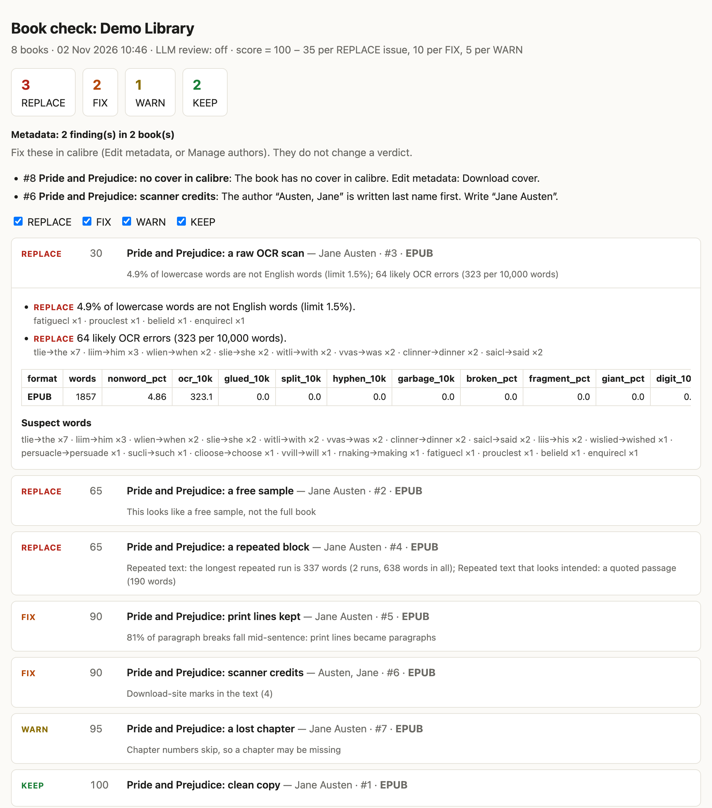

# tidy-calibre-library

[](https://github.com/Nega-ve/tidy-calibre-library/actions/workflows/tests.yml)
[](pyproject.toml)
[](LICENSE)

**Find the damaged e-books in your calibre library before you start to read them.**

It reads every book and gives each one a verdict, with the evidence: OCR errors, broken lines,
lost or repeated text, missing chapters or pages, DRM and broken files. You see which editions
to replace. **It only reads: your library does not change.**

[](https://nega-ve.github.io/tidy-calibre-library/sample-report.html)

[Open the sample report.](https://nega-ve.github.io/tidy-calibre-library/sample-report.html) It
comes from a demo library of 8 books: 2 are sound, and 6 have planted faults.

## Try it

```sh
pipx install git+https://github.com/Nega-ve/tidy-calibre-library
tidy-calibre-library library ~/"Calibre Library"
open out/"Calibre Library"/report.html      # Linux: xdg-open
```

That is all for EPUB books. You need no account and no key. The first run downloads an English
word list (2.6 MB), once.

**No pipx?** Run `brew install pipx` on macOS, or `sudo apt install pipx` on Debian or Ubuntu.
Then run `pipx ensurepath` and open a new terminal. You also need Python 3.10 or newer.

**Other formats** use other programs. If one is missing, the run stops and names it. Books
already checked stay in the cache, so the next run goes on from there.

| Your books | You need | macOS | Debian / Ubuntu |
|---|---|---|---|
| MOBI, AZW3, AZW, FB2, PRC, DOCX, ODT, RTF, TXT | calibre (found in `/Applications` on macOS, on `PATH` elsewhere) | `brew install --cask calibre` | `sudo apt install calibre` |
| PDF | poppler | `brew install poppler` | `sudo apt install poppler-utils` |
| DjVu | djvulibre (optional: without it, DjVu files are listed but not read) | `brew install djvulibre` | `sudo apt install djvulibre-bin` |

**How long it takes:** on an Apple M2 Pro (12 cores), a first run checks about 340 text-only test
EPUBs of 100,000 words a minute. Later runs read only new or changed files, so they take seconds.
MOBI and AZW3 take longer, because calibre converts them first. The cache needs about 26 KB a
book, plus one converted EPUB for each MOBI.

## What the verdicts mean

| Verdict | Means | You do |
|---|---|---|
| **REPLACE** | Damaged beyond a quick fix: lost or shuffled text, a repeated page, missing pages, DRM, a sample edition, a format most readers cannot open | Get another edition |
| **FIX** | A known defect that calibre can repair, or that a cleaner edition avoids | Use the fix in the issue text |
| **WARN** | Maybe a problem: a chapter-number gap, a possible cut-off ending, a repeated passage, dialect-heavy text | Read the evidence, then decide |
| **KEEP** | Nothing found | Nothing |

A book's verdict comes from its **best** format (EPUB first). When an extra format is bad and the
best one is fine, you get a FIX: "delete the MOBI format".

**A KEEP is not a reading verdict.** The checks count non-words and patterns. OCR damage that
makes real words, or a scan with clean words but lost layout, can pass. Read a few pages of any
scanned book before you trust its KEEP, or use the [LLM review](#llm-review-optional-paid).

## A book got REPLACE. What now?

1. Open the book's card in the report, and read the evidence.
2. Get another edition: from the shop that sold it or, for an old book, from
   [Standard Ebooks](https://standardebooks.org) or [Project Gutenberg](https://www.gutenberg.org).
3. In calibre, select the book. Click the arrow beside **Add books**, then **Add files to selected
   book records**. If calibre asks to replace the old file of that format, say yes.
4. If the bad file has another format, remove it: in the book details, right-click the format,
   then click **Delete**.
5. Run the tool again. The new file has a new hash, so it is checked. The other books come from
   the cache.

The repairs for a FIX are in [Fixing what it finds](docs/CHECKS.md#fixing-what-it-finds).

## What it finds

- **Text:** OCR errors (`tlie` for *the*), words run together or split, garbled characters, download-site marks.
- **Layout:** print lines turned into paragraphs, running heads, lost paragraph breaks, photos of printed pages.
- **Missing or repeated:** repeated pages and passages, skipped chapter and page numbers, free samples, cut-off endings.
- **File:** damaged files, DRM, missing chapter files, broken contents links, scans with no text.
- **Library:** duplicates, the wrong book under a title, folders that calibre does not list, author and metadata faults.

Every check and its limit are in [docs/CHECKS.md](docs/CHECKS.md). The limits were tuned on about
650 books read by hand, and [the results are there too](docs/CHECKS.md#how-the-limits-were-set).

```
calibre library (read-only)
   │
   ├─ EPUB ─────────────────────────────────────────┐
   ├─ MOBI/AZW3/FB2/… → ebook-convert → cached EPUB ─┤
   ├─ PDF  → pdftotext, pdfimages ───────────────────┤
   └─ DjVu → djvutxt, ddjvu ─────────────────────────┤
                                                     ▼
          checks: text · layout · duplicates · gaps · pages · metadata
                                                     │
          optional LLM review: ~14 pages per book (paid, off by default)
                                                     ▼
          verdict per book: KEEP · WARN · FIX · REPLACE
                                                     ▼
          out/<library>/report.html (worst first) · report.csv · report.json
```

## Questions

**Does it change my library?** No. It reads each book folder's `metadata.opf` and opens
`metadata.db` read-only. Reports and the cache go to folders of their own.

**Is it safe while calibre runs?** Yes. It uses SQLite's normal locking, and it never writes.

**Does it send my books anywhere?** No. Only with `--llm`, which is off by default, do about 14
pages a book go to OpenRouter.

**Windows?** Not tested. Use WSL.

**Books not in English?** The file, layout, duplicate and gap checks run. The word checks are
English only.

**Where does it keep files?** Reports go to `./out/<library>`. The results, converted EPUBs and
word list go to `~/.cache/tidy-calibre-library`. You can delete that folder at any time.

**How do I remove it?** Run `pipx uninstall tidy-calibre-library`, then delete that folder.

**A verdict is wrong. What can I do?** Please report [a false alarm](https://github.com/Nega-ve/tidy-calibre-library/issues/new?template=false_alarm.yml)
or [a missed defect](https://github.com/Nega-ve/tidy-calibre-library/issues/new?template=missed_defect.yml).
Each false alarm so far became a rule fix and a test.

## Usage

```sh
tidy-calibre-library library LIBRARY [options]   # LIBRARY = the folder, or its metadata.db
tidy-calibre-library files PATH... [options]     # loose files or folders, before you add them
```

| Option | Default | What it does |
|---|---|---|
| `--out DIR` | `./out/<name>` | Where the reports go |
| `--cache DIR` | `~/.cache/tidy-calibre-library` (or `$XDG_CACHE_HOME`) | Check results and converted EPUBs. It can grow to a large share of the library's size when many books are MOBI. |
| `--jobs N` | the CPUs it may use | Files checked in parallel. Each conversion runs `ebook-convert`, so lower it on a small machine. |
| `--only 12,40` | all | Only these calibre book ids |
| `--web-url URL` | none | Calibre-Web base URL: each title in the report links to `URL/book/<id>` |
| `--llm MODE` | `off` | `off`, `all`, `flagged` (only books with an issue), `auto` (`all` if a key is set) |
| `--model ID` | `anthropic/claude-haiku-5.5` | OpenRouter model for the LLM review |
| `--env-file FILE` | `.env` in the current folder | Where the OpenRouter key is read from, if it is not in the environment |

`files` mode treats `X.epub` and `X.mobi` in one folder as two formats of one book, and searches
folders to any depth. It has no metadata checks.

Each run writes three files:

- `report.html`: the worst books first. Each card shows the verdict, the issues with examples, a
  metrics table per format and the suspect words. Filter by verdict at the top.
- `report.csv`: one row per book (verdict, score, best format, the main metrics, issue codes).
- `report.json`: everything, for your own scripts.

A run reads a file again when it is new or changed, or when it could not be finished for a reason
that may pass (a missing tool, a failed conversion, a checker error).

### Docker

The image holds calibre, poppler and djvulibre. It is 656 MB.

```sh
git clone https://github.com/Nega-ve/tidy-calibre-library
cd tidy-calibre-library
docker build -t tidy-calibre-library .
docker run --rm --user "$(id -u):$(id -g)" \
  -v "$HOME/Calibre Library:/books/Calibre Library:ro" \
  -v "$PWD/out:/work/out" -v "$PWD/cache:/cache" \
  tidy-calibre-library library "/books/Calibre Library"
```

## LLM review (optional, paid)

The checks cannot see an OCR error that makes a real word (`modem` for *modern*). With `--llm`, a
small model on [OpenRouter](https://openrouter.ai) reads about 14 pages of each book and rates
them. It costs about $0.001–0.002 a book. Those pages and the title leave your machine, so do not
use it on books you may not share. See [how the rating changes a verdict](docs/CHECKS.md#llm-review-optional-paid).

## For developers

```sh
git clone https://github.com/Nega-ve/tidy-calibre-library
cd tidy-calibre-library
python3 -m venv .venv
.venv/bin/pip install -e ".[dev]"
.venv/bin/pytest
```

It is one package of seven plain Python modules, and one test file. [CONTRIBUTING.md](CONTRIBUTING.md) has a map
of the code and shows how to change a check. Changes are in [CHANGELOG.md](CHANGELOG.md).

## Credits and licence

MIT licence; see [LICENSE](LICENSE).

- [SCOWL](http://wordlist.aspell.net/) word lists, © Kevin Atkinson and others, free to copy and
  use under the SCOWL licence. They are not in this repo: the tool downloads one fixed release and
  checks its sha256.
- [wordfreq](https://github.com/rspeer/wordfreq) (code Apache-2.0, data CC BY-SA 4.0), lxml,
  NumPy, Pillow, Requests.
- [calibre](https://calibre-ebook.com) (GPL-3.0), [poppler](https://poppler.freedesktop.org) and
  [DjVuLibre](https://djvu.sourceforge.net) are run as separate programs.

This project is not affiliated with or endorsed by the calibre project.
